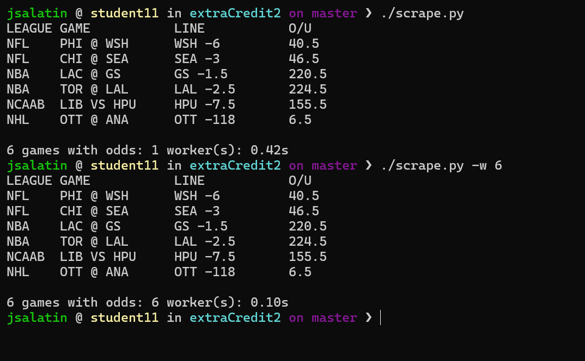

Sports Betting Odds Scraper

This is a python scraper that pulls the current point spread and over/under for every game on ESPN's scoreboard website across many different leagues (NFL, College Football, NBA, College Basketball, NHL, MLB).

Usage

In order to scrape every league with one worker run:
	./scrape.py
In order to scrape every league with 6 concurrent workers run:
	./scrape.py -w 6
In order to scrape a/multiple specific leagues run:
	./scrape.py nfl nba -w 2
The options:
	Usage: ./scrape.py [-w WORKERS] [leagues...]

     -w WORKERS  Number of concurrent workers (default: 1)

Leagues: nfl, ncaaf, nba, ncaab, nhl, mlb (default: all)

Example output:
 
LEAGUE GAME           LINE           O/U
NFL    PHI @ WSH      WSH -6         40.5
NFL    CHI @ SEA      SEA -3         46.5
NBA    LAC @ GS       GS -1.5        220.5
NBA    TOR @ LAL      LAL -3.5       224.5
NCAAB  LIB VS HPU     HPU -7.5       155.5
NHL    OTT @ ANA      OTT -118       6.5

6 games with odds: 1 worker(s): 0.79s

Performance:

Workers: 1
Time(s): 0.42

Workers: 6
Time(s); 0.10

concurrent.futures:

Each league is a seperate HTTP request, and most of the time is spent waiting on the network. With one worker, each request happens one after another, so the total time is all six added up. With a ThreadPoolExecutor and six workers, all six requests are working at the same time, so the total time is the slowest request. Thats why the 6 worker run is much faster. 

Functional Programming:
By itself, functional programming doesnt make the scraper any faster; map and filter are about the same as a regular loop. The benefit is that each step is its own pure function with no shared states. This makes concurrency easy: no thread is ever touching anything that another thread is also touching. Since map and filter are iterators this is lazy, so nothing is copied into the lists until the very end. 

